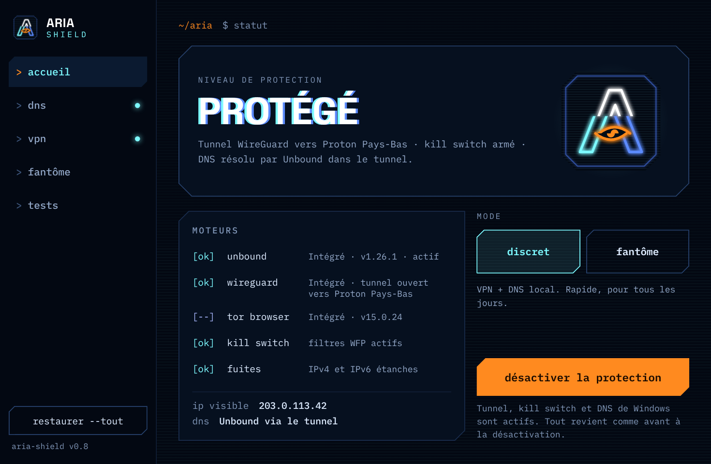
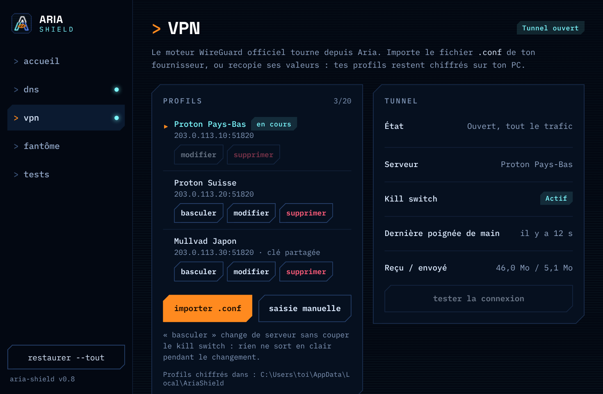

<p align="center">
  
</p>

<h1 align="center">Aria Shield</h1>

<p align="center">
  Un logiciel Windows portable pour naviguer discrètement, en un clic :<br>
  résolveur DNS à toi, VPN avec kill switch, et Tor Browser.<br>
  Rien à installer : tout tient dans un seul exe.
</p>

<p align="center">
  <a href="../../releases/latest"><b>Télécharger la dernière version</b></a> ·
  Windows 10/11 x64 · licence MIT ·
  <a href="https://github.com/ZedjeK/Aria-Shield/actions/workflows/build.yml"></a>
</p>

<p align="center">
  
  
</p>
<p align="center"><sub>Captures avec des données fictives (adresses de documentation 203.0.113.x).</sub></p>

## Pourquoi

Ton FAI voit chaque site que tu visites (par le DNS), peut en bloquer certains, et les sites voient ton adresse IP. Les outils pour y remédier existent, mais il faut les installer, les configurer, et ne pas oublier de tout remettre en place. Aria Shield les réunit dans un seul exe portable, les active en un clic, vérifie qu'ils fonctionnent vraiment, et laisse Windows exactement comme avant quand tu la quittes.

## Ce qu'il fait

| Mode | Ce qui est protégé | Comment |
| --- | --- | --- |
| **Résolveur DNS** | Tes requêtes DNS : plus de DNS du FAI, plus de blocage DNS, DNSSEC validé | Unbound tourne depuis Aria en récursion complète, sans aucun DNS tiers |
| **Discret** | Tout le trafic du PC : ton IP est cachée aux sites, ton FAI ne voit plus rien | Tunnel WireGuard vers ton fournisseur VPN + kill switch qui bloque tout ce qui sort hors du tunnel |
| **Fantôme** | La navigation dans Tor Browser : anonymat fort | Tor Browser intégré, vérifié et tenu à jour par Aria. Combiné au mode Discret, ton FAI ne voit même pas que tu utilises Tor |

**Plusieurs profils VPN** (jusqu'à 20) : importe le fichier `.conf` de ton fournisseur en un clic et change de pays avec « basculer », sans couper la protection.

**Blocage des pubs et des traceurs** (en option, page Résolveur DNS) : le résolveur répond `0.0.0.0` pour les domaines de la liste [OISD small](https://oisd.nl), pour tout Windows et pas seulement le navigateur. Aria télécharge la liste, n'en garde que des noms de domaine valides et écrit elle-même les règles : une liste piégée ne peut rien rediriger, seulement bloquer. Un site ne marche plus ? Ajoute son domaine aux exceptions.

**Toujours active si tu le veux** : fermer la fenêtre range Aria dans la zone de notification, sans rien couper. Dans « réglages », active « Démarrer avec Windows » : Aria se lance à l'ouverture de ta session, sans fenêtre UAC, et réactive ta dernière protection (DNS seul ou mode Discret).

Une page **Tests** vérifie ce qu'Aria annonce : Windows passe bien par le résolveur, aucune fuite d'IP en IPv4 ou IPv6, kill switch actif, et navigateurs dont le « DNS sécurisé » contournerait Aria.

## Installation

1. Télécharge `Aria-Shield.exe` dans les [Releases](../../releases).
2. Lance-le. Windows SmartScreen prévient que l'exe n'est pas signé : « Informations complémentaires », puis « Exécuter quand même ».
3. Accepte la demande de droits administrateur : Aria en a besoin pour modifier le DNS, créer la carte VPN et poser le pare-feu.

### Vérifier l'exe

Chaque release donne l'empreinte SHA-256 de l'exe. Dans PowerShell :

```powershell
Get-FileHash .\Aria-Shield.exe
```

À partir de la v0.9, l'exe est compilé par GitHub Actions directement depuis les sources publiques, avec une attestation de provenance. Avec la [CLI GitHub](https://cli.github.com/) :

```powershell
gh attestation verify .\Aria-Shield.exe -R ZedjeK/Aria-Shield
```

### Où Aria range ses fichiers

Aria ne dépose rien à côté de l'exe. Tout va dans deux dossiers :

| Dossier | Contenu | Accès |
| --- | --- | --- |
| `%USERPROFILE%\.Aria-Shield` | Tes données : profils VPN chiffrés, Tor Browser et ses favoris, cache de l'interface (`webview`) | Ton compte |
| `%PROGRAMDATA%\AriaShield` | Ce qu'Aria exécute en administrateur (Unbound), la photo de ton DNS d'origine et la liste de blocage des pubs | Administrateurs et système uniquement |

Le second est créé déjà verrouillé, pour qu'aucun programme sans droits admin ne puisse y glisser un faux exécutable ou une DLL qu'Aria lancerait ensuite. S'il existe déjà sans avoir été créé par Aria (propriétaire inattendu, ou lien vers un autre dossier), il est mis de côté sous le nom `AriaShield.suspect-<date>` et remplacé par un dossier neuf ; Aria te prévient au lancement. Si le verrouillage échoue, Aria refuse de lancer Unbound.

Si tu actives « Démarrer avec Windows », Aria ajoute une tâche planifiée `\Aria Shield\Démarrage` et une copie de l'exe dans `%ProgramFiles%\Aria Shield` : la tâche lance Aria en administrateur sans rien demander, elle doit donc lancer un exe que seul un administrateur peut modifier, et pas celui de ton Bureau. Lancer une autre version d'Aria remet cette copie à jour.

Les **notifications Windows** (incident, réactivation impossible au lancement, sortie d'Aria) obligent Aria à s'inscrire dans ton registre utilisateur : `HKCU\Software\Classes\AppUserModelId\Aria Shield`, `HKCU\Software\Classes\CLSID\{GUID}` et `HKCU\Software\Aria Shield`. Rien n'y est écrit tant qu'elles sont désactivées, et les désactiver efface ces clés.

**Pour tout désinstaller** : dans « réglages », désactive « Démarrer avec Windows » (tâche et copie retirées) et « Notifications Windows » (clés du registre effacées), clique sur « restaurer --tout », quitte Aria, puis supprime l'exe et ces deux dossiers (le second demande une confirmation administrateur).

Depuis la v0.7, l'ancien dossier `AriaShield-data` des versions précédentes est déplacé automatiquement vers ces emplacements au premier lancement, puis supprimé. Ferme l'ancienne version d'Aria avant de lancer la nouvelle.

Depuis la v0.9, tes données sont dans `.Aria-Shield`, comme pour les autres applis Aria : l'ancien dossier `%LOCALAPPDATA%\AriaShield` y est déplacé au premier lancement (ferme Tor Browser avant). L'ancien cache de l'interface, `%APPDATA%\Aria-Shield.exe`, ne sert plus et peut être supprimé.

Si tu lances Aria depuis un compte standard en saisissant le mot de passe d'un autre compte administrateur, ses données iront dans le profil de ce compte administrateur, et Tor Browser (installé et lancé avec les droits du compte ouvert) ne fonctionnera pas : lance Aria depuis ton propre compte.

## Premiers pas

1. **VPN** : télécharge une configuration WireGuard chez ton fournisseur (Proton VPN, gratuit compris, Mullvad, IVPN…), puis « importer .conf » ou recopie ses valeurs à la main.
2. **Accueil** : mode Discret, puis « activer la protection ». Résolveur, DNS de Windows, tunnel et kill switch démarrent ensemble. Quand rien ne te protège, le logo de la fenêtre est délavé.
3. **Mode Fantôme** : lance Tor Browser depuis Aria pour naviguer anonymement. Aria l'installe au premier lancement et vérifie ses mises à jour.
4. **Tests** : vérifie qu'aucune fuite ne passe, et repère les navigateurs dont le « DNS sécurisé » contournerait Aria.

Juste un DNS sans blocage, sans VPN ? Sur la page Résolveur DNS, démarre le résolveur puis active « Utiliser pour tout Windows ». Ton IP reste alors visible.

Pour changer de pays protection active : page VPN, « basculer » sur un autre profil. Le kill switch reste en place pendant le changement.

Pour revenir à la normale à tout moment : « restaurer --tout », en bas de la barre latérale. Fermer la fenêtre ne coupe rien : pour arrêter Aria, « Quitter » dans le menu de son icône (clic droit, zone de notification) ou dans « réglages ».

## Sécurité

- **Rien ne reste derrière toi** : à la désactivation, quand tu quittes Aria et même en cas de plantage, ton DNS d'origine revient, le kill switch disparaît (session de pare-feu dynamique) et le pilote VPN est retiré.
- **Profils VPN chiffrés** avec DPAPI, liés à ton compte Windows. Les clés ne quittent jamais la partie Go d'Aria : l'interface ne les reçoit pas, même pour les afficher. À l'import d'un `.conf`, c'est Aria qui lit le fichier ; les commandes qu'il pourrait contenir (`PostUp`…) sont ignorées, jamais exécutées.
- **Aucune fuite pendant une bascule** : changer de serveur garde la même carte réseau et le même kill switch ; si le nouveau serveur ne répond pas, Aria revient sur l'ancien.
- **Composants vérifiés** : chaque binaire embarqué vient de la source officielle, avec sa signature vérifiée (voir plus bas). Aria revérifie leur empreinte ou leur signature avant chaque utilisation.
- **Tor Browser jamais en administrateur** : Aria tourne en admin, mais installe, met à jour et lance Tor Browser avec tes droits normaux. L'installation et les mises à jour passent par un assistant (le même exe, relancé sans élévation) : Aria ne fait que lire le dossier de Tor Browser, si bien qu'un programme sans droits ne peut pas s'en servir pour faire écrire Aria ailleurs sur le disque.

### Limites à connaître

- Le blocage des pubs agit sur les noms de domaine : les pubs servies depuis le domaine du site lui-même (YouTube, par exemple) passent, et un navigateur dont le « DNS sécurisé » est activé contourne Aria (la page Tests le signale). Dans le navigateur, un bloqueur comme uBlock Origin reste plus efficace ; les deux se complètent.
- La liste OISD est téléchargée sur ta machine à l'activation, puis chaque semaine au lancement, sans signature : c'est pour cela qu'Aria la filtre. Elle n'est pas embarquée dans l'exe (elle est sous licence GPLv3, Aria sous MIT). Avec la liste, Unbound prend une quinzaine de Mo de mémoire en plus.

- L'exe n'est pas signé (Authenticode) : vérifie son empreinte ou son attestation (voir « Vérifier l'exe »).
- Le mode Fantôme rend anonyme ce que tu fais **dans Tor Browser**, pas le reste du PC.
- Un VPN cache ton IP, il ne te rend pas anonyme vis-à-vis de ton fournisseur VPN.
- Projet personnel, sans audit de sécurité indépendant.

## Provenance des composants embarqués

| Composant | Source | Vérification |
| --- | --- | --- |
| Unbound 1.26.1 | `unbound-1.26.1.zip`, NLnet Labs | Signature PGP « NLnet Labs releases signing key G2 » (`2310 1869 0C4D 903E F419 146A A144 323D EAAC DF45`). SHA-256 de `unbound.exe` : `8fd7f2d2ad66261ea09e345dd0ffcde7428c404f474fcf459ef6c3d05470fa24` |
| WireGuardNT 1.1 | `wireguard-nt-1.1.zip`, download.wireguard.com | Signature Authenticode « WireGuard LLC ». SHA-256 de `wireguard.dll` : `b1b85e072c45d81358be29d94c599dc76652f912be8c0f0a41e2d5d89a6461d3`. Chargé en mémoire depuis l'exe, jamais écrit sur le disque |
| Tor Browser 15.0.24 | `tor-browser-windows-x86_64-portable-15.0.24.exe`, dist.torproject.org ou son archive officielle | Signature PGP « Tor Browser Developers (signing key) » (`EF6E 286D DA85 EA2A 4BA7 DE68 4E2C 6E87 9329 8290`), revérifiée par Aria à chaque installation ou mise à jour |

Deux paquets sont dérivés de [wireguard-windows](https://git.zx2c4.com/wireguard-windows/) (MIT) : le kill switch (`src/internal/killswitch`), modifié pour autoriser le processus Aria au lieu du service WireGuard, et le pilote (`src/internal/wgnt`), modifié pour charger `wireguard.dll` en mémoire depuis l'exe.

## Compiler soi-même

Prérequis : [Go](https://go.dev/dl/) 1.25 ou plus et [Node.js](https://nodejs.org/) LTS.

```powershell
powershell -ExecutionPolicy Bypass -File .\build.ps1
```

Le script télécharge Tor Browser 15.0.24 sur torproject.org (trop lourd pour le dépôt), installe le CLI [Wails v3](https://v3.wails.io/) si besoin, génère le projet dans `.work\`, y applique `src\` et produit `Aria-Shield.exe` à la racine. L'icône fournie dans `src/build/windows/icon.ico` est utilisée telle quelle.

GitHub fait la même chose à chaque modification ([`.github/workflows/build.yml`](.github/workflows/build.yml)) : signature de Tor Browser vérifiée, tests Go, compilation. Pousser un tag `vX.Y` prépare la release en brouillon, avec son empreinte et son attestation ; elle est publiée à la main, après relecture.

## Lire le code

Tout le code d'Aria est commenté en français : chaque fichier commence par son rôle, chaque fonction dit ce qu'elle fait et surtout pourquoi. Pour s'y retrouver :

1. [`src/shieldservice.go`](src/shieldservice.go) : la carte de tout ce que l'interface peut demander, et la séquence de protection (`Protect`).
2. [`src/internal/sysdns/manager.go`](src/internal/sysdns/manager.go) : comment Aria bascule le DNS de Windows et garantit le retour en arrière.
3. [`src/internal/vpn/`](src/internal/vpn) : profils, import des `.conf`, tunnel et bascule à chaud.
4. [`src/frontend/src/lib/state.svelte.js`](src/frontend/src/lib/state.svelte.js) : le lien entre l'interface et le Go.

Les paquets `killswitch` et `wgnt` reprennent le code de WireGuard tel quel (commentaires anglais compris), pour rester faciles à comparer avec l'original.

## Structure

```text
.github/workflows/build.yml     # compilation et releases sur GitHub
build.ps1                       # compilation locale
docs/                           # logo et captures du README
src/
├── main.go                     # appli Wails, fenêtre, zone de notification
├── shieldservice.go            # méthodes appelées par l'interface
├── startup.go                  # démarrage avec Windows, reprise de la protection, quitter
├── adblock.go                  # blocage des pubs : activation, mise à jour, exceptions
├── notify.go                   # notifications Windows (incidents, sortie)
├── internal/
│   ├── dnsengine/              # Unbound embarqué : extraction, lancement, tests
│   ├── sysdns/                 # bascule et restauration du DNS de Windows
│   ├── paths/                  # emplacements des données, verrouillage, migration
│   ├── prefs/                  # réglages et dernière protection (reglages.json)
│   ├── blocklist/              # liste de blocage : téléchargement, filtre, règles Unbound
│   ├── autostart/              # tâche planifiée et copie protégée dans Program Files
│   ├── toastreg/               # nettoyage du registre des notifications
│   ├── vpn/                    # profils chiffrés, import .conf, tunnel WireGuardNT
│   ├── wgnt/                   # pilote WireGuardNT chargé en mémoire (dérivé de wireguard-windows, MIT)
│   ├── killswitch/             # pare-feu WFP (dérivé de wireguard-windows, MIT)
│   ├── leak/                   # mesure de l'IP publique
│   ├── torbrowser/             # Tor Browser embarqué, mises à jour signées
│   ├── browsers/               # détection du DNS sécurisé des navigateurs
│   └── sysx/                   # commandes sans console, droits admin
├── frontend/src/               # interface Svelte (polices embarquées, logo en SVG)
└── build/                      # icône, propriétés de l'exe, manifest administrateur
```

## Licence

Code d'Aria Shield sous licence [MIT](LICENSE). Les composants tiers gardent leur propre licence : voir [LICENCES-TIERS.txt](LICENCES-TIERS.txt).
